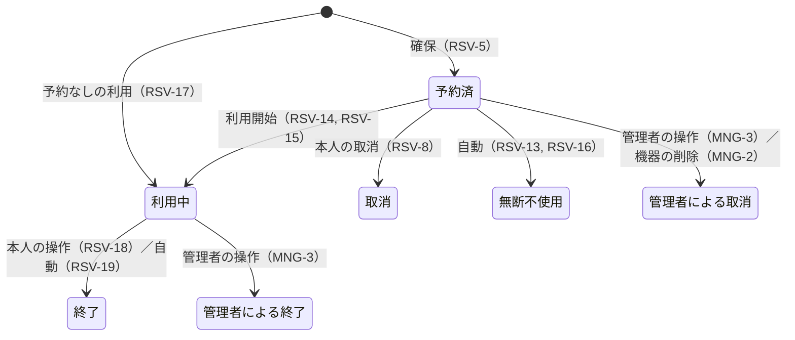

# データのまとまりと予約の状態

- 状態：決定
- 日付：2026-11-16
- 関係する要件：USR-3〜USR-7, ADM-2, ADM-3, RSV-1〜RSV-20, RSV-25, RSV-26, MNG-1〜MNG-3, LOG-2, LOG-3, LOG-5, NFR-3, FUT-4, FUT-5
- 前提：[architecture.md](architecture.md)（すべて台帳の SQLite に置く）

ここでは、何をまとまりとして持つか、それぞれが何を持ち、何が一意か、予約の状態がどう移るかを決める。列の型や索引などの表の定義は詳細設計で決める。

## 決定

### 1. まとまりの一覧

```
利用者 1 ─── * 予約 * ─── 1 機器
                │
                └ 状態・時間帯の変化はすべて「記録」へ

管理者        共有された情報        数値の設定
（それぞれの操作も「記録」へ）
```

| まとまり | 持つもの | 一意になるもの | 消し方 |
| --- | --- | --- | --- |
| 利用者 | 生徒か教員か、学籍番号（正規化したもの）、名前（現在の）、期生（生徒だけ。現在の） | 「生徒か教員か」と「学籍番号」の組（USR-4） | 消さない |
| 機器 | 名前、削除した時刻 | 削除していない機器どうしの名前（MNG-1） | 削除した時刻を入れるだけで、行は残す（LOG-2） |
| 予約 | 機器、利用者、開始時刻、終了時刻、状態、管理者による取消・終了の原因、予約なしの利用で始めたか、作った時刻 | なし（重ならないことは判定で守る。下の 4） | 消さない |
| 管理者 | ID、表示用の名前、パスワード（ハッシュ）、削除した時刻 | ID。削除したものも含めて一意（ADM-2） | 機器と同じ |
| 共有された情報 | 値（ハッシュ）、設定した時刻 | ― | 消さない。最新の1件が現在の値。1件もなければ未設定（ADM-3） |
| 数値の設定 | 項目、値、有効になる時刻 | ― | 消さない。変更のたびに1件足す（下の 3） |
| 記録 | 下の 5 | ― | 消さない（失敗の記録だけは logging.md による） |

どのまとまりにも、内部で使う番号（連番）を付け、ほかのまとまりからはこの番号で指す。学籍番号や機器の名前で指さないのは、名前が変わったり、削除した名前が再び使われたりするため（MNG-1）。

認証の状態（端末ごとの証明、試行の回数）は auth.md で決める。

### 2. 利用者

- 名前と期生は、利用者ごとに現在の値を1つだけ持つ。予約は利用者の番号だけを持ち、名前を写さない。表示するときに利用者から引くので、置き換えれば過去の予約の表示も新しい名前になる（USR-7「現在結びついている名前を表示する」）。
- 置き換える前の名前・期生は記録に残す（USR-7, LOG-1）。利用者の行には持たない。
- 学籍番号は正規化した形（半角、英字は小文字にそろえる）で持つ（USR-4）。正規化の手順は `src/lib/` にまとめる。
- 利用者の行をいつ作り、いつ名前を置き換えるか（どの操作を「入力や変更を伴う操作」とするか）は、利用者として誰かを API にどう渡すかと一緒に screens-and-api.md で決める。

### 3. 数値の設定は履歴で持つ

RSV-25 の3つの数値は、上書きせず、変更のたびに「項目・値・有効になる時刻」の行を足す。有効になる時刻は、変更した時刻の秒を切り捨てたもの（RSV-26）。

ある時刻 T に有効な値は、「有効になる時刻が T 以下の行のうち、最も新しいもの」とする。同じ分に2回変更したら、後の変更が勝つ。初期値（3件、15分、1440分）は、台帳を最初に作るときに1行ずつ入れる。

理由：

- 猶予は「その予約の開始時刻の時点で有効な値」による（RSV-26）。開始時刻は利用開始前に変えられる（RSV-9）ので、確保した時点で猶予を予約に写しておくことはできない。開始時刻 S に有効な値を、履歴から引けばよい。
- 「開始時刻がその時刻と同じ予約には、変更後の値を使う」（RSV-26）は、「T 以下」で比べることで満たせる。
- 数値の変更より前に起きた変化（RSV-25, RSV-22）を後から計算し直しても、結果が変わらない。

件数の上限と長さの上限は、操作した時点（秒を切り捨てた現在時刻）に有効な値を使う。

### 4. 予約

#### 持つもの

| 項目 | 内容 |
| --- | --- |
| 機器 | 変えない（RSV-9） |
| 利用者 | 変えない |
| 開始時刻・終了時刻 | 分単位（TIM-3）。時間帯の変更（RSV-9, RSV-10）、利用開始の前倒し（RSV-15）、利用の終了（RSV-18, MNG-3）で書き換える。書き換える前の値は記録に残す（LOG-3） |
| 状態 | 下の 4.1 の7つのどれか |
| 原因 | 管理者による取消・終了のときだけ。v0.1.0 は「管理者の操作」「機器の削除」（LOG-3）。FUT-5 で「メンテナンス」を足す |
| 予約なしの利用 | 予約なしの利用（RSV-17）で始めたか。一度決めたら変えない（時間帯を変えても件数に数えない。RSV-17） |
| 作った時刻 | 実際の時刻（TIM-5）。先着順（RSV-4）の確認と追跡に使う |

終了した予約の終了時刻は、利用した時間帯の終わりになる（VIW-1）。予定していた終了時刻は記録からたどる。

猶予の長さは予約に持たず、3 のとおり開始時刻から引く。

#### 重ならないこと

「同じ機器で、予約済・利用中の予約どうしの時間帯が重ならない」（RSV-3）は、SQLite の制約では表せない（範囲の重なりを禁じる制約がない）。台帳の中で判定と書き込みを割り込まれずに行うことで守る（architecture.md 3）。

#### 4.1 状態の移り方



時間帯を確保しているのは予約済と利用中だけ（RSV-1）。ほかの5つは終わりの状態で、そこから移らない。

| 移り方 | だれが | 変化の時刻 | 時間帯の書き換え |
| --- | --- | --- | --- |
| 予約済 → 利用中 | 本人 | 操作した時刻 | 開始時刻より前なら、開始時刻を秒を切り捨てた現在時刻に（RSV-15） |
| 予約済 → 取消 | 本人 | 操作した時刻 | なし |
| 予約済 → 無断不使用 | 自動 | 開始時刻＋猶予と終了時刻の早いほう（RSV-13, RSV-16, RSV-21） | なし |
| 予約済 → 管理者による取消 | 管理者 | 操作した時刻 | なし |
| 利用中 → 終了（本人） | 本人 | 操作した時刻 | 終了時刻を秒を切り捨てた現在時刻に（RSV-18） |
| 利用中 → 終了（自動） | 自動 | 終了時刻（RSV-19, RSV-21） | なし |
| 利用中 → 管理者による終了 | 管理者 | 操作した時刻 | 終了時刻を秒を切り捨てた現在時刻に（MNG-3） |

「終了」は本人の操作でも自動でも同じ状態にし、どちらによるかは記録で区別する（LOG-3 は「終了」と「管理者による終了」の区別だけを求めている）。

それぞれの移り方を許す条件（いつまでできるか、何と重なってはいけないか）は、ルールとして `src/rules/` に書き、詳細設計でルールごとに定める。自動の変化を反映する順序と、同じ時刻での操作との前後（RSV-22）は time-and-concurrency.md で決める。

### 5. 記録

記録は、何が起きたかを1件ずつ足していく表として持つ。1件に「いつ（実際の時刻。自動の変化はルール上の時刻）」「だれが（利用者・管理者・自動・認証の試行の相手）」「何を（種類）」「何に（予約・機器・利用者・管理者の番号）」「変化の前後の値」を持つ。

記録の対象は次のとおり。持ち方の詳細（列の分け方、絞り込み、失敗の記録の上限）は logging.md で決める。

| 対象 | 要件 |
| --- | --- |
| 予約の状態の変化と時間帯の変更 | LOG-3 |
| 利用者の名前・期生の置き換え | USR-7, LOG-1 |
| 管理者の操作（アカウント、共有された情報、機器、予約、数値） | LOG-4 |
| 管理者の認証の成功と失敗 | LOG-4 |

機器・利用者・期間で絞り込めるよう（FUT-4）、記録には機器と利用者の番号を、関係するものがあれば必ず入れる。

### 6. 時刻の持ち方

時刻はすべて同じ表し方（日本時間に換算する前の、ある時点を表す数値）で持ち、日本時間への換算は表示と日付の区切り（VIW-1 の「指定した日」）でだけ行う。具体的な表し方は time-and-concurrency.md で決める。

### 7. データ量の見積もり（NFR-3）

| もの | 想定の規模で5年 | 10倍で5年 |
| --- | --- | --- |
| 予約 | 20件/日 × 365日 × 5年 ≒ 3.7万件 | 37万件 |
| 予約の記録（1件あたり3〜5件とみる） | 約18万件 | 約180万件 |
| 利用者 | 480人 | ― |

1件を0.5KB と多めに見ても、想定の規模で約110MB、10倍で約1.1GB。これが無料プランの保存容量に収まるかは、公式の上限を確かめて logging.md に書く（認証の失敗の記録を含めて見積もる）。

## 採らなかった案

| 案 | 理由 |
| --- | --- |
| 予約に、確保した時点の猶予の長さを写す | RSV-9 で開始時刻が変わると、RSV-26 の「開始時刻の時点で有効な値」とずれる |
| 数値の設定を1行で上書きして持つ | 開始時刻の過ぎた予約の猶予がわからなくなる（RSV-26）。変更前の値が消える（LOG-5） |
| 予約に名前・期生を写す | 現在の名前を表示する USR-7 に反する |
| 学籍番号を利用者の番号の代わりに使う | 生徒と教員で同じ文字列がありうる（USR-4 の組で識別）。表示しない値（VIW-2）がほかの表に広がる |
| 予約の状態の変化を、状態を持たずに記録から毎回組み立てる | 空きの確認のたびに記録をたどることになり、遅く、読みにくい。状態は予約に持ち、記録は追跡のために持つ |
| 「終了」を本人の操作と自動で別の状態にする | 要件の状態（RSV-1）は7つ。区別は記録で足りる |

## 要件の読み方（確認済み）

- **猶予のうちの本人の取消（RSV-8）。** 「利用開始前（予約済）であれば」は状態で決まると読む。開始時刻を過ぎていても、猶予のうちで予約済なら、本人は取り消せる（結果は「取消」で、「無断不使用」ではない）。2026-11-16 に開発者が確認した。
