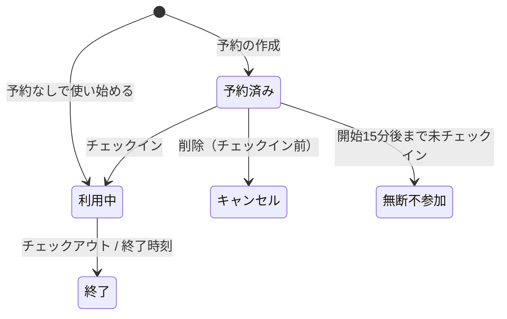

# DXプレイス予約システム 要件定義

最終更新: 2026-11-08

## 1. 概要

DXプレイスの3Dプリンタ1台と高性能PC2台を、予約によって公平に使えるようにするWebシステム。校内関係者を全面的に信頼する前提で、手続きの手軽さを優先する。

### 学校側の要件

1. 空きが、ひと目でわかる
2. 見た人が、使いたいと思える
3. 予約しないと使えない仕組みになっている
4. 使わなくなったら、必ずキャンセルされる仕組みになっている

### 構成

- フロントエンド: GitHub Pages（静的ホスティング）。素の HTML / CSS / JavaScript（ES Modules、ビルド工程なし）
- バックエンド: Supabase（PostgreSQL。管理者の認証のみ Supabase Auth）
- テスト: pgTAP（`supabase/tests/` に置き、`supabase test db` で実行する）

### スコープ

- 対象: 予約と利用の管理のみ
- 対象外: 機器の利用講習、材料の管理、画像のアップロード、プッシュ通知、PWA
- 学校の情報ポリシー上、外部サービスに個人情報を置くことは問題ないものとして進める

---

## 2. 利用者と認証

校内の人であることは入口トークン（Cookie）で、誰であるかは氏名で判別する。一般の利用者にパスワードはない。

### 利用者

- 対象: 全学年の生徒と教員。両者の権限は同じ
- 識別子: 生徒は「氏名＋期生」、教員は「氏名」
- 保持する情報: 氏名、期生（生徒のみ）、メモ（任意。所属やメールアドレスなど）。これらはすべて他の利用者に公開される
- メモはプレーンテキストとし、URLのみ自動でリンクにする

### 入口トークンとCookie

- 管理者が発行した入口URL（またはそのQRコード）を開くと、トークンがCookieに保存され、トップページに移動する
- トークンはURLのフラグメント（`#t=...`）に含め、読み込み後に `history.replaceState` でアドレスバーから消す
- 有効なトークンは常に1つだけで、有効期限はない。管理者が再発行すると、古いトークンは即座に無効になる
- Cookieの有効期限は約400日（ブラウザの上限付近）
- Cookieを持たない状態では、空き状況の閲覧、ログイン、アカウント作成のいずれもできない
- トークンが無効になった利用者には、入口URLが更新されたことを伝える画面を表示する

### アカウント

- 作成: トップページから作成するほか、ログアウト状態で予約しようとしたときにも、その流れの中で作成する
- ログイン状態の保存: localStorageに利用者IDを保存し、RPC関数にはトークンと一緒に渡す
- 識別子の衝突: 既存のアカウントと同じ識別子の場合は「同一人物か」を確認する。同一人物ならそのアカウントでログインし、別人なら表記を変えて登録する（例: 山田太郎A）
- 氏名・期生の変更: 本人が可能。衝突した場合は作成時と同じ確認を行う
- 削除: 管理者のみ。本人は削除できない

### 管理者

- 一般の利用者とは完全に別のレイヤーで管理する。Supabase Auth のメールアドレスとパスワードで認証する
- 管理者の追加は、管理者アカウントの作成によって行う
- 管理者が機器を使う場合は、別に一般のアカウントを作る
- 初期の管理者: 開発者本人と担当教員

---

## 3. リソース

3DプリンタとPCは、システム上は区別されない「名前とメモを持つリソース」として扱う。

- 属性: 名前、メモ（管理者が設定するMarkdown）
- メモの画像は外部URLの参照のみ。アップロードは行わない
- 追加・名前の変更・削除・一時停止: 管理者のみ
- 内部では変化しないIDで管理し、名前を変更しても過去の記録との対応が崩れないようにする
- 一時停止（故障時など）: 削除とは別の状態とし、その間は予約とチェックインができない
- 削除: 論理削除とし、未来の予約はキャンセル状態にする。過去のログでは削除前の名前を表示する

---

## 4. 予約ルールと状態遷移

予約は先着順で、1人が同時に保持できる予約は「予約済み＋利用中」で3件まで。予約なしの利用は上限を超えていても始められる。

### 基本ルール

- 単位: リソースごとに分単位。準備と片付けを含めた占有時間を予約する
- 予約できる時間帯・期間・1回の長さ: 制限なし
- リソース同士は独立しており、同じ人が複数のリソースを同時に占有してよい
- 同じリソースで時間帯が重なる予約はできない
- 上限（3件）は新しく予約を作るときだけ判定する。予約なしの利用も「利用中」として数えるため、合計が一時的に3件を超えることがある

### 操作ごとの条件

| 操作                 | できる期間                           | 条件                                                   |
| -------------------- | ------------------------------------ | ------------------------------------------------------ |
| 予約の作成           | いつでも                             | 重複なし、上限3件以内                                  |
| 予約の削除           | チェックインまで                     | —                                                      |
| 開始時刻の変更       | 開始時刻まで（チェックイン前）       | 重複なし                                               |
| 終了時刻の変更・延長 | 終了時刻まで                         | 同じリソースの次の予約の開始時刻まで                   |
| チェックイン         | 開始時刻から15分後まで（開始前も可） | 下記「開始前のチェックイン」参照                       |
| 予約なしで使い始める | 現在時刻が空いているとき             | 終了時刻は次の予約の開始時刻まで。上限を超えていても可 |
| チェックアウト       | 利用中                               | —                                                      |

### 開始前のチェックイン

開始時刻より前にチェックインするときは、次のどちらかを選ぶ。

- 予約を前倒しする: 開始時刻をチェックイン時刻に変更する。直前の時間帯が空いていることが条件
- 予約なしとして使う: 元の予約は残し、別に予約なしの利用を始める。終了時刻は、自分の予約を含む次の予約の開始時刻まで。予約が長期間先にあるときを想定している

### 状態

状態は保存せず、記録した時刻と `now()` から導出する。導出は1つの関数（またはビュー）にまとめ、すべての処理と表示がそれを使う。

```
cancelled_at が NULL でない                              → キャンセル
checked_out_at が NULL でない、または end_at <= now()       → 終了
checked_in_at が NULL でない                             → 利用中
start_at + 15分 < now()                                 → 無断不参加
それ以外                                                  → 予約済み
```



- 無断不参加・キャンセル・終了の予約は枠を占有しない。行は削除せず残す
- 終了時刻を過ぎた利用は自動的に「終了」となる（強制チェックアウト）
- 定期実行の仕組み（cron）は不要

### 予約の競合

画面の更新は手動の再読み込みのみなので、同じ枠への同時予約が起こりうる。重複と上限の判定はRPC関数の中で、リソースの行を `SELECT ... FOR UPDATE` でロックしてから行い、後から来た予約は拒否してその旨を表示する。状態が時刻とともに変わるため、`EXCLUDE` 制約は使わない。

---

## 5. 画面とUI

要件2「使いたいと思える」は、操作の手軽さで満たす。主な利用端末はスマートフォンで、PCでも使う。専用の端末は置かない。デザインはシンプルなものとし、装飾よりも見やすさと操作のしやすさを優先する。

### 操作の目標

| 操作                         | 目標                                                       |
| ---------------------------- | ---------------------------------------------------------- |
| 空き状況を確認する           | トップページを開いた直後に見える。操作は不要               |
| 予約する（ログイン済み）     | 空いている枠をタップ → 時間を確認 → 確定の3タップ          |
| 予約する（初めて使う人）     | 上の流れの途中で氏名と期生を入力するだけ。事前の登録は不要 |
| 予約なしで使い始める         | 「今すぐ使う」→ 終了時刻を選ぶ → 確定                      |
| チェックイン／チェックアウト | 自分の予約の欄のボタンを1タップ                            |

### トップページ（スマートフォン）

上から順に並べる。

1. 重要なお知らせ（ある場合のみ）
2. 自分の予約の状態とアクションボタン（例:「15分以内にチェックインしてください」「利用中: あと23分」）
3. 空き状況のグリッド

### トップページ（PC）

左右の2領域に分ける。左側に重要なお知らせ、自分の予約、お知らせの一覧を、右側にグリッドを置く。中身はスマートフォンと共通で、CSSのブレークポイントで配置だけを切り替える。

### グリッド

- 向き: スマートフォンとPCで共通。列がリソース、縦方向が時間
- 初期表示: 今日の現在時刻の付近。現在時刻を線で示す
- 日付の切り替え: 前後の矢印、「今日」ボタン、日付の選択
- 状態の区別: 空き、予約済み、利用中、自分の予約を、色と模様の両方で区別する
- 分単位の予約は、15分刻みなどの目盛りの上に実際の時間の分だけ帯を描いて表す
- リソースが増えて画面に収まらない場合は横にスクロールする
- 各リソースの列見出しに「今すぐ使う」ボタンを置き、現在時刻が空いているときだけ押せるようにする。見出しをタップするとリソースのメモを表示する
- 予約をタップ（PCではマウスを重ねる）すると、予約者の氏名とメモを表示する

### 予約の入力

- タップした位置を開始時刻にし、終了時刻は「+30分」「+1時間」などのボタンで選ぶ。細かい指定は時刻の入力欄で補う
- PCでは、空いている範囲をマウスでドラッグして開始時刻と終了時刻を指定できる
- 重複や上限超過は確定前に画面で示す。最終的な判定はサーバー側で行う
- 予約の端をドラッグして時刻を変える操作は、最初は実装しない

### 再読み込み

ヘッダーに再読み込みボタンを置き、その横に最終更新時刻（例:「16:42更新」）を表示する。自動更新は行わない。

---

## 6. 管理機能とお知らせ

管理者は予約・利用者・リソース・入口URL・お知らせを管理できる。管理画面での操作もすべてサーバー側で権限を判定する。

### 管理機能

| 機能                   | 内容                                                                           |
| ---------------------- | ------------------------------------------------------------------------------ |
| 予約の操作             | 任意の予約を削除・変更・強制終了できる                                         |
| 枠の封鎖               | 理由（例: メンテナンス）を付けて、リソースの時間帯を押さえられる。上限の対象外 |
| ログの閲覧             | 利用者・リソース・期間で絞り込んで閲覧できる                                   |
| 利用停止               | アカウントを停止し、予約とチェックインをできなくする                           |
| アカウントの削除と復元 | 論理削除と、その取り消し                                                       |
| リソースの管理         | 追加、名前とメモの変更、一時停止、削除                                         |
| 入口URLの発行          | トークンを再発行し、入口URLとQRコードを生成する                                |
| 管理者の追加           | 新しい管理者アカウントを作成する                                               |
| お知らせの管理         | 作成、編集、削除                                                               |

### お知らせ

- 内容: タイトルと本文（Markdown）
- 公開期間: 開始日時と終了日時を設定できる。終了日時は省略可能（無期限）。公開中かどうかは時刻から導出する
- 重要度:「通常」と「重要」。重要なものはトップページの上部に常に表示し、通常のものは一覧に表示する
- 対象: 全体向けのみ。特定のリソースに関する告知はリソースのメモに書く
- 既読の管理はしない。必要なら、各ブラウザの localStorage に最後に見た時刻を保存して「新着」の印を付ける
- 削除は状態の遷移として扱う

### Markdownの表示

リソースのメモとお知らせの本文は、`marked` でHTMLに変換した後、`DOMPurify` で無害化してから表示する。管理者のアカウントが乗っ取られた場合に、全利用者のブラウザでスクリプトを実行されるのを防ぐため。

---

## 7. データとログ

データは物理的に削除せず、削除もすべて状態の遷移として扱う。すべての操作をログに残す。

### データの構成

| データ   | 主な項目                                                                                                     |
| -------- | ------------------------------------------------------------------------------------------------------------ |
| 利用者   | 氏名、期生、メモ、停止日時、削除日時                                                                         |
| 管理者   | Supabase Auth のユーザー                                                                                     |
| リソース | 名前、メモ、一時停止の状態、削除日時                                                                         |
| 予約     | 利用者、リソース、開始・終了日時、チェックイン・チェックアウト日時、キャンセル日時、予約なしの利用か、封鎖か |
| お知らせ | タイトル、本文、重要度、公開期間、削除日時                                                                   |
| トークン | 入口トークン（有効なものは常に1つ）                                                                          |
| 操作ログ | 操作者の種別（利用者／管理者）、操作者、操作、対象、日時                                                     |

### 論理削除の扱い

- 一意性制約は部分インデックスにする（例: `create unique index on users(name, cohort) where deleted_at is null`）。管理者が削除したアカウントと同じ識別子でも新しく登録できる。誤って削除したアカウントは、新しく作り直さず管理者が復元する
- 削除済みを除いたビューを用意し、RPC関数は原則としてそのビューを使う
- アカウントを削除したときは、メモを消去し、氏名はログの表示用に残す。未来の予約はキャンセル状態にし、利用中の予約は終了させる

### 操作ログ

予約の作成・変更・削除、チェックイン、チェックアウト、管理者の操作をすべて記録する。パスワードのない設計では、トラブルが起きたときに追跡できる唯一の手段になる。

---

## 8. 非機能要件と技術方針

すべての業務ルールを Supabase の RPC関数に集約し、テーブルへの直接アクセスは許可しない。

### API（RPC方式）

- `anon` ロールからはテーブルへのアクセスをすべて取り消し、`security definer` の関数だけを公開する
- 一般利用者の関数は、引数で受け取った入口トークンを冒頭で確認する。管理者用の関数は `auth.uid()` が管理者として登録されているかを確認する
- 各関数には `set search_path` を必ず指定する
- 時刻の判定はすべてサーバー側の `now()` で行う。クライアントの時計は使わない
- 1つの操作は1つの関数で行い、判定と書き込みを同じトランザクションで済ませる

### セキュリティ

- `anon` キーはフロントエンドで公開されるので、それを前提に設計する
- 一般利用者の本人確認は行わない（信頼モデル）。なりすましへの備えは操作ログでの追跡に限る
- 利用者のメモはプレーンテキストで表示し、Markdown は DOMPurify で無害化する

### 時刻

- タイムゾーンは Asia/Tokyo。データベースには `timestamptz` で保存する

### 運用と保守

- データベースの容量: 操作ログが1日150行程度でも、年間約30MBの見込み。無料プランの500MBは問題にならない
- 一定期間アクセスがないと停止する仕様: 無料プランでは7日間アクティビティがないと一時停止される。GitHub Actions のスケジュール実行で数日ごとに軽いクエリを送る
- バックアップ: 無料プランには自動バックアップがない。同じ GitHub Actions で定期的に `pg_dump` を実行し、非公開の場所に保存する
- GitHub Actions のスケジュール実行が、リポジトリの更新がないと無効化される仕様の有無と期間は要確認
- 開発者の卒業後に保守を引き継ぐ人と、そのための文書を用意する
- システムが停止している間は、予約なしで自由に使ってよいものとする

---

## 9. 学校側の要件との対応

要件3と要件4はWebシステムだけでは強制できないので、利用者を信頼する前提のもとで実質的に満たす。学校側にはこの前提を含めて説明する。

| 要件                              | 実現方法                                                                                                                                | 前提・限界                                                                                                                     |
| --------------------------------- | --------------------------------------------------------------------------------------------------------------------------------------- | ------------------------------------------------------------------------------------------------------------------------------ |
| 1. 空きがひと目でわかる           | トップページを開いた直後に、現在時刻付近のグリッドを表示する                                                                            | 自動更新はなく、再読み込みで最新にする                                                                                         |
| 2. 使いたいと思える               | 予約までの手数を最小にし（ログイン済みなら3タップ）、初めての人も事前登録なしで予約できる。リソースのメモとお知らせで活用例を紹介できる | デザインはシンプルにし、見た目の魅力より手軽さで訴える                                                                         |
| 3. 予約しないと使えない           | 予約の手間を減らし、予約なしでもその場で「今すぐ使う」から利用を記録できるようにする                                                    | 予約も記録もせずに使うことは、物理的には防げない                                                                               |
| 4. 使わなくなったら必ずキャンセル | 開始15分後までにチェックインしなければ枠を解放する。チェックアウトか終了時刻で利用を終える                                              | チェックインはどこからでもできるため、来ていない人のチェックインは防げない。チェックアウトし忘れた場合は終了時刻まで枠が埋まる |
